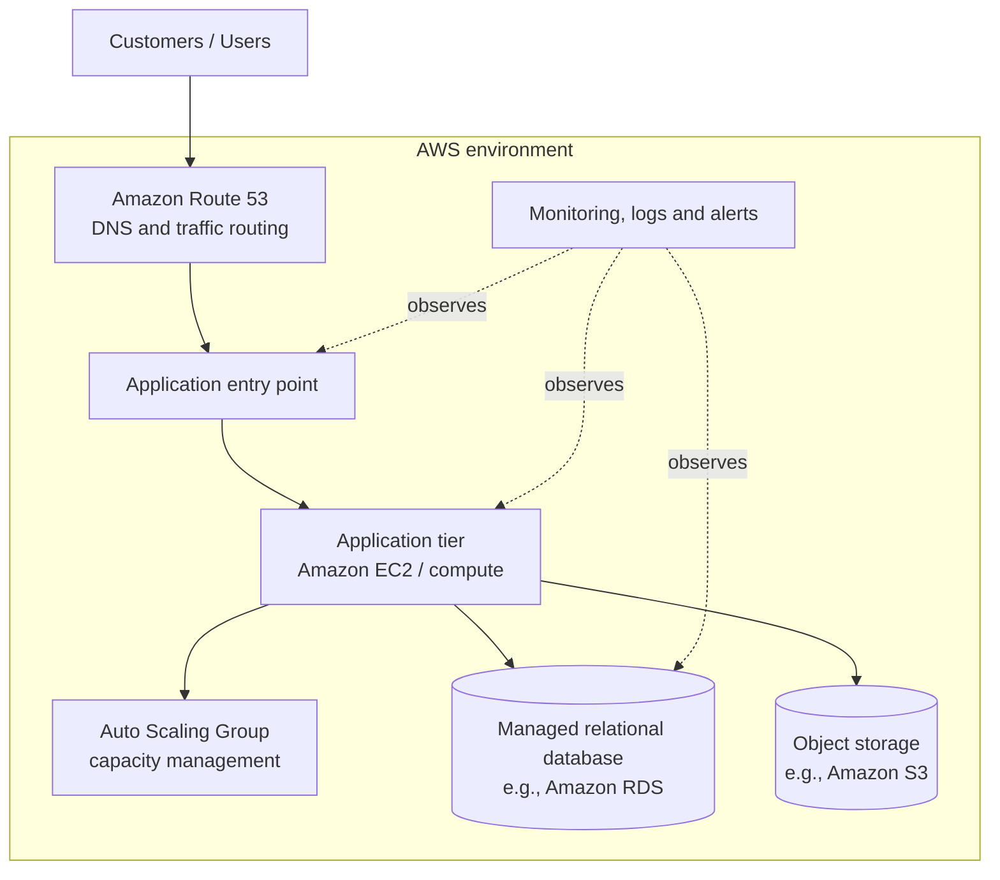

# Capital One AWS Migration — Conceptual Architecture

**Course:** IT457 – Cloud Computing | **Group:** 41  
**Contributor:** Aryan Rathod (202301164) | **Status:** Week 2 conceptual design

## 1. Purpose and scope
This diagram summarizes cloud architecture concepts relevant to the Capital One AWS migration case study. It is a **conceptual diagram**, not a claim that every component shown was used across Capital One's entire production environment. Confirm application-specific components against the cited Capital One Tech article before describing them as case facts.

## 2. Conceptual architecture

**Diagram caution:** The diagram uses common AWS building blocks to illustrate the design. Do not state that Amazon EC2, S3, RDS, Route 53, Auto Scaling Groups, or the exact topology above were all used together in every Capital One workload unless the sources confirm that. If a service is only proposed for the group's practical exercise, label it as proposed rather than historical.

## 3. Component descriptions

| Component | Role in the conceptual design | Design consideration |
|---|---|---|
| Users | Access the customer-facing application | Availability and response time |
| Route 53 | DNS resolution and routing | Confirm exact routing behavior for the chosen design |
| Application entry point | Receives requests and directs them to the application | Could be a load balancer or another entry service; specify only if selected |
| Compute / EC2 | Runs application code | Security groups, patching, scaling and health checks |
| Auto Scaling Group | Adjusts compute capacity according to policies | Scaling thresholds and cooldowns |
| Managed database / RDS | Stores structured application data | Backups, access control and availability configuration |
| Object storage / S3 | Stores objects such as static assets or uploaded files | Bucket access, encryption and lifecycle policies |
| Monitoring and logs | Supports observation and troubleshooting | Metrics, logs, alarms and retention |

## 4. Migration and deployment approach
A safe conceptual migration sequence is:
1. Inventory the application's components and dependencies.
2. Prepare the target AWS environment and baseline security settings.
3. Deploy and test the application in the target environment.
4. Validate performance, monitoring, access controls and recovery procedures.
5. Shift a limited portion of traffic when a controlled rollout is supported.
6. Monitor errors and latency, then continue or roll back according to defined criteria.
7. Document results and estimate operating costs.

This is a proposed general workflow. The precise process used in Capital One's documented application migration should be described only as the cited article supports.

## 5. Architecture quality attributes
- **Availability:** define health checks, alerting, and recovery procedures.
- **Scalability:** test how the application responds to increased load.
- **Security:** apply least-privilege access, protected secrets, encryption, and appropriate network rules.
- **Observability:** record useful metrics, logs, and errors without exposing sensitive data.
- **Cost control:** tag resources, stop unused test resources, and estimate costs before deployment.

## References
1. AWS, [Capital One case study — all-in on AWS](https://aws.amazon.com/solutions/case-studies/capital-one-all-in-on-aws/)
2. Capital One Tech, [Moving a Customer-Facing App to AWS](https://www.capitalone.com/tech/cloud/moving-customer-facing-apps-to-aws/)
3. AWS, [AWS Architecture Center](https://aws.amazon.com/architecture/)
