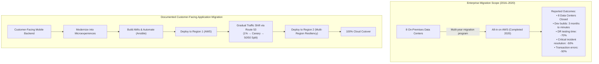

# Capital One's Migration to AWS — Case Study Analysis

**Course:** IT457 – Cloud Computing  
**Group:** 41  
**Contributor:** Kavish Patel (202301074)  
**Deliverable:** Week 2 Case Study Analysis  
**Repository Path:** `docs/week-2/case-study-analysis.md`  

---

## 1. Executive Summary

In November 2016, Capital One Financial Corporation announced that it had selected Amazon Web Services (AWS) as its predominant cloud infrastructure provider, marking one of the earliest commitments by a major, federally regulated commercial bank to move core banking workloads to the public cloud. By 2020, AWS and Capital One announced that the institution had completed the decommission and exit of all eight of its traditional on-premises data centers, transitioning to an all-in cloud footprint on AWS.

This case study examines Capital One's enterprise cloud transformation. It analyzes the company's business context, strategic drivers, migration methodologies, core architectural concepts, and vendor-reported outcomes. To ensure academic rigor, this analysis strictly distinguishes:
1. **Enterprise-wide outcomes** reported across Capital One's entire infrastructure from **application-specific migration patterns** reported for an individual customer-facing workload.
2. **Directly sourced empirical facts** from **general cloud computing analysis**.
3. **Vendor-reported metrics** from independently audited financial and operational disclosures.

---

## 2. Company Context

Capital One Financial Corporation is a Fortune 100 diversified financial services company based in the United States. It specializes in consumer credit cards, auto loans, checking and savings accounts, and commercial banking services, serving tens of millions of customers and processing billions of transactions annually.

As a major financial institution, Capital One operates within a stringent regulatory environment overseen by authorities such as the Federal Reserve, the Office of the Comptroller of the Currency (OCC), and the Consumer Financial Protection Bureau (CFPB). Regulatory and business obligations impose strict standards on:
- High availability and transaction consistency for consumer accounts.
- Data protection, confidentiality, and segregation of sensitive customer information.
- Business continuity, operational resilience, and disaster recovery.
- Rigorous compliance auditing, access governance, and change management.

Historically, Capital One managed its IT operations using a traditional corporate data-center model. Workloads were hosted across eight private data centers, relying on vendor-packaged software, physical server hardware, storage area networks (SANs), and outsourced operations. Over time, physical infrastructure constraints created operational friction that ran counter to the institution’s desire to innovate rapidly as a digital-first financial enterprise.

---

## 3. Cloud-First Strategy

In November 2016, Amazon and Capital One formally announced that Capital One had chosen AWS as its predominant cloud infrastructure provider ([Amazon Press Release, 2016](https://press.aboutamazon.com/2016/11/capital-one-selects-aws-as-its-predominant-cloud-infrastructure-provider)). This announcement reflected an enterprise-level "cloud-first" strategy initiated under Chief Executive Officer Richard Fairbank and Chief Information Officer Rob Alexander.

The cloud-first strategy was built around four foundational pillars:
- **Transition from Cost Center to Software-Led Enterprise:** Reorienting Capital One's identity from an outsourcer of third-party financial software to an engineering-driven company that designs, builds, and maintains proprietary digital products.
- **Universal Cloud Destination:** Designating AWS as the target platform for both new application development and systematic legacy application migration.
- **Re-architecting Over Pure Lift-and-Shift:** Avoiding simple lift-and-shift migrations where legacy software is cloned unchanged into virtual machines; instead, modernizing software into decoupled, modular microservices and managed infrastructure.
- **Full Exit from Physical Infrastructure:** Setting an explicit enterprise objective to exit all physical on-premises data centers entirely, eliminating the dual overhead of running hybrid infrastructure over the long term.

---

## 4. Business and Technical Motivation

The decision to migrate from private data centers to AWS was driven by specific technical and business constraints inherent in traditional infrastructure:

### 4.1 Infrastructure Provisioning Latency
In physical data centers, procuring and provisioning environments required purchasing hardware, racking and cabling servers, configuring network switches, and securing approvals across multiple operational teams. According to the [AWS Case Study (2020)](https://aws.amazon.com/solutions/case-studies/capital-one-all-in-aws/), establishing a new development environment in Capital One's legacy infrastructure took approximately three months. This multi-month lead time delayed new feature development and limited developer agility.

### 4.2 Elasticity and Inelastic Capacity Planning
Consumer financial applications experience pronounced traffic cycles, including daily spikes during morning hours, cyclical peaks during payment deadlines, and unpredictable surges during economic events. In a physical data center, infrastructure must be sized for peak capacity, leaving significant compute and storage resources idle during off-peak windows. Conversely, unexpected traffic surges risked degrading response times or exhausting capacity.

### 4.3 Disaster Recovery and Resilience Complexity
Operating disaster recovery (DR) across geographically separated physical data centers required maintaining duplicate hardware, configuring complex storage mirroring, and coordinating extensive manual failover testing. These DR tests were disruptive, labor-intensive, and infrequent.

### 4.4 Deployment Frequency and Software Delivery Bottlenecks
Monolithic codebases hosted on shared physical hardware necessitated coordinated, high-risk, off-hours deployment windows. If an error emerged during deployment, rollback procedures were slow and error-prone, creating organizational hesitation around deploying code frequently.

---

## 5. Migration Scope and Approach

To evaluate Capital One's cloud journey accurately, academic analysis must differentiate between the **enterprise-wide migration program** and the **application-specific migration patterns** documented in engineering literature.

### 5.1 Enterprise-Wide Migration Scope
The enterprise-wide migration encompassed the entirety of Capital One's IT estate:
- **Scope of Data Centers:** Full decommission and physical exit from eight private data centers, completed in 2020 ([AWS Case Study, 2020](https://aws.amazon.com/solutions/case-studies/capital-one-all-in-aws/)).
- **Workload Diversity:** Thousands of core production applications, internal analytical platforms, customer support workflows, and critical banking systems.
- **Workforce Transformation:** Retraining thousands of analysts and software engineers in cloud technologies, automated testing, and continuous integration/continuous delivery (CI/CD) pipelines.

### 5.2 Application-Specific Migration Approach: The Customer-Facing Mobile App
The primary technical details of Capital One's workload cutover strategy are published in the first-party engineering article *Moving a Customer-Facing App to AWS* ([Capital One Tech, 2019](https://www.capitalone.com/tech/cloud/moving-customer-facing-apps-to-aws/)). This source describes the migration of Capital One's flagship customer-facing mobile banking application and illustrates an incremental, risk-mitigated cutover methodology:

1. **Deconstruction into Microexperiences:** Rather than moving the mobile backend as a monolithic application, engineering teams decomposed customer interactions into modular, self-contained functional components termed "microexperiences" (e.g., viewing balances, checking transactions, executing bill payments).
2. **Standardized Environment Baking with AMIs:** Server configurations and operating dependencies were encapsulated into custom Amazon Machine Images (AMIs). Post-provisioning configuration and runtime setup were automated using Ansible.
3. **Single-Region Validation:** The team deployed the initial cloud stack within a single AWS Region, establishing connectivity and verifying baseline application behavior under test conditions.
4. **Gradual Traffic Shifting (Canary Cutover):** Rather than executing a high-risk "big-bang" cutover, Capital One utilized Amazon Route 53 to manage DNS and dynamically shift production traffic:
   - *Canary Phase:* Approximately 1% of live customer traffic was initially routed to the AWS environment, allowing engineers to validate real-world latency, telemetry, and error rates.
   - *Milestone Scaling:* Traffic was systematically increased in stepped intervals, achieving a 50/50 split between the legacy data center and the new AWS environment.
5. **Multi-Region Resiliency Expansion:** After validating performance in the primary AWS region, Capital One stood up the application in a second AWS Region, establishing an active/active multi-region deployment model to ensure failover capability and regional disaster resilience.

> [!IMPORTANT]
> **Scope Distinction:** The microexperience decomposition, Route 53 weighted DNS shifting, and dual-region active/active architecture described above are verified specifically for the customer-facing mobile application documented by Capital One Tech. They should not be assumed to have applied uniformly to every workload across the eight decommissioned data centers (e.g., mainframe or batch data processing workloads).

---

## 6. Architecture Concepts and AWS Services

The case study references several foundational AWS services and architectural patterns. The table below outlines their functional roles, architectural significance, and the exact scope of evidence supporting their use:

| AWS Service / Architecture Concept | Functional Role | Architectural Significance | Evidence Scope & Sourced Usage |
|---|---|---|---|
| **Amazon EC2** *(Elastic Compute Cloud)* | Virtualized compute instances | Provides on-demand, scalable compute capacity hosting application services. | **Enterprise-wide & Application-specific:** Explicitly cited in the [AWS Case Study (2020)](https://aws.amazon.com/solutions/case-studies/capital-one-all-in-aws/) and [Capital One Tech (2019)](https://www.capitalone.com/tech/cloud/moving-customer-facing-apps-to-aws/). |
| **Amazon S3** *(Simple Storage Service)* | Object storage system | Offers scalable storage for documents, application assets, logs, and data backups. | **Enterprise-wide:** Explicitly cited as a core adopted service in the [AWS Case Study (2020)](https://aws.amazon.com/solutions/case-studies/capital-one-all-in-aws/). |
| **Amazon RDS** *(Relational Database Service)* | Managed relational database engine | Automates database provisioning, maintenance, OS patching, and automated backups. | **Enterprise-wide & Application-specific:** Cited in the [AWS Case Study (2020)](https://aws.amazon.com/solutions/case-studies/capital-one-all-in-aws/) and identified as the data store target in [Capital One Tech (2019)](https://www.capitalone.com/tech/cloud/moving-customer-facing-apps-to-aws/). |
| **Amazon Route 53** | Highly available DNS and traffic routing | Performs domain name resolution, health checking, and weighted DNS routing. | **Application-specific:** Sourced directly to the mobile application migration in [Capital One Tech (2019)](https://www.capitalone.com/tech/cloud/moving-customer-facing-apps-to-aws/). |
| **Auto Scaling Groups (ASGs)** | Dynamic capacity management | Automatically adjusts EC2 instance counts based on health checks and demand metrics. | **Application-specific:** Documented in [Capital One Tech (2019)](https://www.capitalone.com/tech/cloud/moving-customer-facing-apps-to-aws/) for mobile app elasticity and blue/green deployments. |
| **Blue/Green Deployment Pattern** | Release management strategy | Runs two identical environments (Blue active, Green staging); switches traffic instantly. | **Application-specific:** Sourced to [Capital One Tech (2019)](https://www.capitalone.com/tech/cloud/moving-customer-facing-apps-to-aws/) for zero-downtime application updates. |
| **Multi-Region Deployment** | Geographically separated infrastructure | Deploys active application infrastructure across separate AWS physical geographic regions. | **Application-specific:** Documented in [Capital One Tech (2019)](https://www.capitalone.com/tech/cloud/moving-customer-facing-apps-to-aws/) for mobile application resiliency. |
| **Custom AMIs & Ansible Automation** | Infrastructure-as-code & configuration | Standardizes base OS images and automates instance-level configuration drift management. | **Application-specific:** Verified in [Capital One Tech (2019)](https://www.capitalone.com/tech/cloud/moving-customer-facing-apps-to-aws/). |

---

## 7. Outcomes Reported by AWS

All quantitative performance improvements and milestone achievements documented in this section originate directly from the official vendor case study published by Amazon Web Services ([AWS Case Study, 2020](https://aws.amazon.com/solutions/case-studies/capital-one-all-in-aws/)):

| Reported Operational Metric | Legacy Baseline / Previous State | Reported Cloud Outcome | Primary Sourced Attribution |
|---|---|---|---|
| **Data Center Footprint** | 8 on-premises data centers | **0 data centers** (full exit completed in 2020) | AWS Case Study (2020) |
| **Development Environment Build Time** | ~3 months | **Reduced to minutes** | AWS Case Study (2020) |
| **Disaster Recovery (DR) Test Duration** | Baseline testing duration | **70% reduction** in test execution time | AWS Case Study (2020) |
| **Critical Incident Resolution Time** | Baseline MTTR (Mean Time to Resolution) | **50% reduction** | AWS Case Study (2020) |
| **Transaction Error Rates** | Baseline operational error frequency | **50% reduction** in transaction errors | AWS Case Study (2020) |

> [!NOTE]
> **Source Attribution and Evidentiary Status:** These metrics represent self-reported outcomes published in an AWS marketing case study. They do not represent independently audited financial statements or peer-reviewed academic benchmarks. While they demonstrate substantial directional improvements in operational efficiency, they reflect aggregate vendor figures and should be cited as vendor-published data.

---

## 8. Business and Operational Implications

Analyzing Capital One's transition through the lens of core cloud computing principles illustrates several structural shifts in business and engineering operations:

### 8.1 Velocity and Time-to-Market
By reducing development environment creation from three months to minutes, Capital One eliminated a primary bottleneck in its software delivery lifecycle. In practical terms, software teams could provision isolated environments on demand, experiment with new features, run automated test suites, and teardown resources without competing for shared physical hardware. This agility enabled faster delivery of digital banking features to consumer end-users.

### 8.2 Operational Resilience and Fault Isolation
Transitioning from physical disaster recovery sites to multi-region cloud deployments changed Capital One's resilience model:
- Hardware failures are abstracted by the cloud provider.
- Applications can leverage multiple Availability Zones (AZs) within a single region to survive data-center-level power or network interruptions.
- Deploying across multiple AWS regions isolates applications from regional service disruptions, provided data replication and DNS failover are correctly architected.

### 8.3 Organizational Restructuring and DevSecOps
Managing infrastructure through software code (Infrastructure as Code) altered engineering responsibilities. Instead of submitting infrastructure tickets to central operations teams, developers assumed end-to-end operational responsibility for their applications (DevOps). Security requirements were integrated directly into the deployment pipeline (DevSecOps), baking compliance checks and hardening policies into AMIs and CI/CD pipelines.

### 8.4 Shift from Capital Expenditure (CapEx) to Operational Expenditure (OpEx)
The decommission of eight physical data centers eliminated long-term capital investments in real estate, physical server hardware, SAN arrays, cooling infrastructure, and periodic hardware refreshes. In exchange, Capital One incurred recurring operational cloud expenses based on compute, storage, and networking utilization. This financial shift improves operational flexibility, but it introduces the ongoing challenge of cloud financial management (FinOps) to prevent unconstrained resource consumption.

---

## 9. Limitations of Available Sources

Academic evaluation requires identifying the boundaries and limitations of the primary literature used in this analysis:

1. **Vendor Self-Reporting Bias:** The primary quantitative metrics (e.g., 70% DR improvement, 50% incident reduction) originate from AWS promotional and marketing case-study publications. AWS has a commercial incentive to present positive operational outcomes, and no independent third-party audit of these metrics is available.
2. **Absence of Enterprise-Wide Financial Data:** The reviewed sources do not disclose the total dollar expenditure of the migration, ongoing annual AWS run-rate costs, or net financial savings resulting from the data-center exit. While supplementary AWS studies on serverless computing note cost reductions of "up to 90% for specific workloads" ([AWS Lambda Case Study](https://aws.amazon.com/solutions/case-studies/capital-one-lambda-ecs-case-study/)), this applies strictly to isolated microservices and cannot be conflated with enterprise-wide IT expenditure.
3. **Selective Technical Disclosure:** Published engineering articles (e.g., Capital One Tech) describe modern, well-architected applications such as the mobile servicing platform. They do not disclose the architectural compromises, technical debt, or legacy refactoring challenges involved in migrating back-office legacy applications or mainframe systems.
4. **Omission of Proprietary Security Controls:** Because Capital One is a federally regulated financial institution, published case studies deliberately omit granular architectural details regarding virtual private cloud (VPC) peering topologies, firewall rule sets, encryption key management hierarchies (KMS), and regulatory audit mechanisms.

---

## 10. Open Research Questions

To develop a more comprehensive evaluation of Capital One's cloud migration, the following questions remain open for continued investigation:

1. **Total Cost of Ownership (TCO) & Net ROI:** What was the total financial investment required to execute the enterprise migration (including refactoring costs, dual-run data center operations, and staff training), and what is the verified net financial impact compared to pre-migration baseline data-center budgets?
2. **Workload Sequencing and Decommissioning Milestones:** Across the multi-year timeline between the 2016 partnership announcement and the 2020 final data-center exit, what was the exact sequencing of workloads (e.g., migrating stateless mobile backends first, followed by analytical data warehouses, followed by core transaction ledgers)?
3. **Mainframe and Core Banking Systems Modernization:** How did Capital One address highly stateful, mainframe-dependent core banking ledgers during the data-center exit, and what specific cloud patterns replaced legacy mainframe transaction processing?
4. **Cloud Governance and Post-Migration Security:** What specific compliance and governance frameworks were established to maintain regulatory alignment with the Federal Reserve and OCC across tens of thousands of cloud resources, and how are identity and resource permissions governed across development teams?

---

## 11. Conclusion

Capital One's migration from eight on-premises data centers to AWS represents a foundational landmark in modern enterprise cloud computing. By completing its data-center exit in 2020, Capital One demonstrated that large, heavily regulated financial institutions can successfully operate core banking workloads in the public cloud.

The critical insight from this case study is that successful enterprise cloud transformation is not achieved through simple lift-and-shift infrastructure relocation. Capital One’s documented outcomes were enabled by pairing infrastructure migration with architectural modernization: decomposing monolithic backends into microexperiences, standardizing immutable server images via AMIs and automation, implementing canary traffic shifts via Route 53, and adopting multi-region redundancy.

While vendor-reported operational improvements—such as reducing development environment build times from three months to minutes and cutting disaster recovery test times by 70%—highlight the agility of cloud infrastructure, academic rigor demands recognizing the limits of public disclosures. The lack of enterprise financial data, the marketing nature of vendor metrics, and the selective visibility into individual applications emphasize that cloud computing provides powerful capabilities, but its business value depends fundamentally on engineering discipline, architectural design, and rigorous operational governance.

---

## 12. References

1. **Amazon Web Services.** (2020). *Capital One Case Study — All-in on AWS*. AWS Customer Success Stories.  
   URL: [https://aws.amazon.com/solutions/case-studies/capital-one-all-in-aws/](https://aws.amazon.com/solutions/case-studies/capital-one-all-in-aws/)  
   *Verified Content:* Enterprise exit from eight data centers; environment build times reduced from ~3 months to minutes; 70% decrease in DR testing time; 50% decrease in critical incident resolution time; 50% decrease in transaction errors; adoption of EC2, S3, RDS.

2. **Capital One Tech.** (2019). *Moving a Customer-Facing App to AWS*. Capital One Technology Blog.  
   URL: [https://www.capitalone.com/tech/cloud/moving-customer-facing-apps-to-aws/](https://www.capitalone.com/tech/cloud/moving-customer-facing-apps-to-aws/)  
   *Verified Content:* Application-specific migration of mobile servicing platform; microexperience decoupled design; custom AMIs and Ansible automation; Auto Scaling Groups and blue/green deployments; Amazon Route 53 DNS weighted traffic routing (1% canary to 50/50 split); dual-region active/active expansion.

3. **Amazon.** (2016, November 28). *Capital One Selects AWS as Its Predominant Cloud Infrastructure Provider*. Amazon Press Center.  
   URL: [https://press.aboutamazon.com/2016/11/capital-one-selects-aws-as-its-predominant-cloud-infrastructure-provider](https://press.aboutamazon.com/2016/11/capital-one-selects-aws-as-its-predominant-cloud-infrastructure-provider)  
   *Verified Content:* Formal strategic partnership announcement; selection of AWS as predominant cloud infrastructure provider; executive vision regarding technology-led banking transformation and software development velocity.
