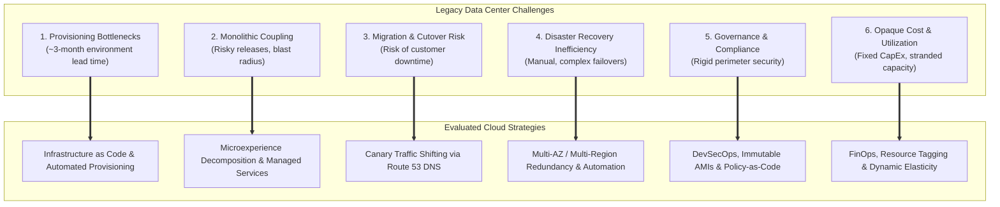

# Capital One AWS Migration — Problem Analysis and Solution

**Course:** IT457 – Cloud Computing  
**Group:** 41  
**Contributor:** Kavish Patel (202301074)  
**Deliverable:** Week 2 Problem Analysis and Solution Strategy  
**Repository Path:** `docs/week-2/problem-and-solution.md`  

---

## 1. Problem Statement

Operating critical banking services within a traditional on-premises data-center paradigm presents a structural tension between operational stability and digital innovation. Historically, Capital One Financial Corporation relied on eight private enterprise data centers to host its core transaction processing, account servicing, and customer-facing banking channels. In this environment, infrastructure management was characterized by lengthy hardware procurement cycles, static capacity sizing, disruptive manual disaster recovery exercises, and monolithic release cycles.

As consumer banking transitioned toward real-time digital channels (such as mobile banking applications, instant fraud notifications, and streaming transactions), the physical data-center architecture constrained organizational agility. Engineering teams faced multi-month provisioning delays for new environments, while capacity constraints forced either costly over-provisioning for peak loads or vulnerability to service degradation during traffic surges.

To address these challenges, Capital One embarked on an enterprise-wide cloud transformation, selecting Amazon Web Services (AWS) as its predominant cloud provider in November 2016 ([Amazon Press Release, 2016](https://press.aboutamazon.com/2016/11/capital-one-selects-aws-as-its-predominant-cloud-infrastructure-provider)) and completing the full exit from all eight data centers in 2020 ([AWS Case Study, 2020](https://aws.amazon.com/solutions/case-studies/capital-one-all-in-aws/)). 

However, migrating an entire financial institution to the public cloud introduces significant technical, architectural, and operational problems. This document provides a rigorous, source-grounded analysis of these problems across six core operational dimensions, details evaluation strategies and validation metrics, and outlines a practical validation framework for a hands-on cloud migration exercise.

> [!IMPORTANT]
> **Evidentiary Discipline:** This analysis strictly distinguishes between **verified facts** sourced from official case publications and **general cloud-computing analytical frameworks**. Recommendations and architectural solutions evaluated herein do not imply that Capital One deployed identical configurations across every internal workload. Furthermore, vendor-reported metrics are attributed directly to their publishers, and no unsupported total financial figures or enterprise-wide cost savings are assumed.

---

## 2. Key Problem Dimensions and Technical Analysis

### 2.1 Infrastructure Provisioning Latency

#### The Problem
In legacy enterprise IT environments, establishing infrastructure for a new application or development project requires a sequential, multi-stakeholder procurement process. Teams must specify hardware requirements, generate purchase orders, await physical shipment, install servers in data center racks, configure physical cabling and top-of-rack switches, carve out storage area network (SAN) volumes, and install operating systems. 

#### Verified Case Evidence
According to the official [AWS Case Study (2020)](https://aws.amazon.com/solutions/case-studies/capital-one-all-in-aws/), Capital One's baseline average development-environment build time in its on-premises data centers was **approximately three months**. This extended lead time delayed product iterations and impeded fast feedback loops. Following the migration to AWS, this provisioning duration was reduced to **minutes**.

#### Analytical Evaluation
The solution to provisioning bottlenecks lies in programmatic infrastructure provisioning (Infrastructure as Code) and virtualized compute pools. Rather than treating infrastructure as physical hardware, resources are defined declaratively via configuration templates and instantiated via cloud APIs. In a practical deployment, this is evaluated by measuring the elapsed time required to deploy an application stack from a version-controlled repository to a fully reachable runtime environment.

---

### 2.2 Application Modernization and Monolithic Coupling

#### The Problem
Migrating legacy applications using a strict "lift-and-shift" (rehosting) approach transfers pre-existing architectural weaknesses directly into the cloud. Monolithic enterprise architectures often bundle diverse capabilities (e.g., authentication, transaction processing, profile management, and account statements) into a single codebase and shared runtime. In this topology:
- Any component failure risks cascading across the entire application runtime.
- Scaling individual high-demand functions requires scaling the entire monolith.
- Coordinated releases require cross-team synchronization and extensive regression testing.

#### Verified Case Evidence
In its published engineering article *Moving a Customer-Facing App to AWS* ([Capital One Tech, 2019](https://www.capitalone.com/tech/cloud/moving-customer-facing-apps-to-aws/)), Capital One documented the modernization of its flagship customer-facing mobile banking application. The engineering team avoided a direct rehosting approach by:
1. Decomposing monolithic backend servicing layers into modular, independent functional components termed **"microexperiences"** (e.g., balance lookup, transaction history, card locking).
2. Packaging standardized server runtimes into custom **Amazon Machine Images (AMIs)** with post-provisioning configuration automated through **Ansible**.
3. Adopting managed databases via **Amazon RDS** to abstract database maintenance and backups.

#### Analytical Evaluation
Microexperience and microservice decompositions isolate fault domains and enable independent scaling. However, academic analysis must emphasize that this refactoring is engineering-intensive. Not every enterprise application warrants full decomposition; legacy core ledgers or commercial off-the-shelf (COTS) software may require encapsulation or managed database replatforming rather than full code rewrites.

---

### 2.3 Migration Risk and Cutover Continuity

#### The Problem
In commercial banking, unplanned customer-facing downtime directly compromises consumer trust, generates immediate regulatory scrutiny, and causes financial losses. Executing an instantaneous cutover ("big-bang" cutover)—where DNS records or network gateways are abruptly switched 100% from on-premises to the cloud—carries severe risks:
- Hidden configuration discrepancies between environments can cause widespread outages.
- Unanticipated network latency or database locking issues under production concurrency can degrade performance.
- Rolling back a failed cutover requires reversing global DNS caches and reconciling divergent transaction records.

#### Verified Case Evidence
To mitigate cutover risk during the mobile application migration, Capital One utilized a phased, telemetry-driven traffic-shifting methodology ([Capital One Tech, 2019](https://www.capitalone.com/tech/cloud/moving-customer-facing-apps-to-aws/)):
- **Initial Baseline Deployment:** Deployed the application stack within a single AWS Region and validated basic connectivity.
- **Canary Cutover (~1% Traffic):** Used **Amazon Route 53** weighted DNS routing to route approximately 1% of live production traffic to AWS, exposing the cloud stack to real-world network traffic while containing blast radius.
- **Stepped Volume Ramp-up:** Progressively increased traffic through predetermined milestones until reaching a **50/50 split** between the on-premises data center and the AWS region.
- **Multi-Region Redundancy:** Stood up a second AWS Region for active/active failover before completing final traffic migration.

#### Analytical Evaluation
Weighted traffic shifting and blue/green deployment patterns decouple deployment from release. Production health can be continuously validated against live traffic baselines (measuring p95/p99 latency, HTTP 5xx error rates, and CPU utilization) with the operational capacity to instantly roll back via DNS without user disruption.

---

### 2.4 Availability, Fault Domains, and Disaster Recovery

#### The Problem
Traditional data-center disaster recovery (DR) strategies typically rely on active-passive pairings between primary and secondary physical sites. Maintaining secondary physical sites requires purchasing duplicate hardware, maintaining complex SAN replication links, and conducting periodic disaster simulation drills. These manual DR tests are disruptive to ongoing operations, costly to execute, and often reveal recovery procedure gaps only after catastrophic failures occur.

#### Verified Case Evidence
In its published case study, AWS reported that Capital One achieved significant operational resilience outcomes ([AWS Case Study, 2020](https://aws.amazon.com/solutions/case-studies/capital-one-all-in-aws/)):
- **Disaster-recovery testing time** decreased by **70%**.
- **Critical incident resolution time** (Mean Time to Resolution / MTTR) decreased by **50%**.
- **Transaction errors** decreased by **50%**.

Furthermore, for the customer-facing mobile application, Capital One expanded its cloud footprint across **multiple AWS Regions** to achieve geographic fault isolation ([Capital One Tech, 2019](https://www.capitalone.com/tech/cloud/moving-customer-facing-apps-to-aws/)).

#### Analytical Evaluation
Cloud architecture mitigates availability risks by distributing application instances across multiple physical **Availability Zones (AZs)** within a region and across separate **AWS Regions**. AZs provide independent power, cooling, and network connectivity, protecting workloads against local physical disruptions. DR testing transitions from manual failovers to programmatic chaos engineering and automated recovery testing.

> [!NOTE]
> **Attribution Caution:** The 70% DR test reduction, 50% incident resolution improvement, and 50% error reduction metrics are vendor-reported figures published by AWS. They represent aggregate case study benchmarks and should not be treated as independently audited guarantees applicable to every application.

---

### 2.5 Security, Governance, and Regulatory Compliance

#### The Problem
Operating in the financial sector requires compliance with stringent regulatory standards, including Federal Reserve supervisory expectations, OCC guidance, FFIEC requirements, and PCI-DSS standards for cardholder data. Traditional security relied on perimeter-based defenses ("castle-and-moat"), where firewalls protected internal networks under the assumption that internal traffic was trusted. Transitioning to a shared public cloud infrastructure requires moving from physical perimeters to logical, identity-centric access controls, automated governance, and continuous compliance monitoring.

#### Verified Case Evidence
Capital One’s strategy focused on embedding security and governance directly into engineering pipelines (DevSecOps) and leveraging cloud automation ([Amazon Press Release, 2016](https://press.aboutamazon.com/2016/11/capital-one-selects-aws-as-its-predominant-cloud-infrastructure-provider); [Capital One Tech, 2019](https://www.capitalone.com/tech/cloud/moving-customer-facing-apps-to-aws/)):
- Standardized security baselines were codified into custom base AMIs, ensuring that every newly launched instance contained mandatory hardening, logging agents, and security configurations.
- Configuration drift was controlled using automated deployment tooling (Ansible).

#### Analytical Evaluation
Under the AWS Shared Responsibility Model, AWS manages the security *of* the cloud (physical infrastructure, hypervisors, and data center facilities), while the enterprise remains strictly responsible for security *in* the cloud (IAM policies, VPC network configurations, data encryption at rest and in transit, and application code security). Public case studies deliberately omit proprietary security rule sets, VPC peering topologies, and encryption key management hierarchies (KMS) for operational security reasons.

---

### 2.6 Cost Transparency, Elasticity, and Governance (FinOps)

#### The Problem
In on-premises data centers, infrastructure is funded via Capital Expenditure (CapEx). Physical servers, storage arrays, and network switches are depreciated over three to five years, creating fixed infrastructure overhead regardless of actual workload utilization. In the cloud, infrastructure transitions to Operational Expenditure (OpEx), where compute, storage, and networking are billed dynamically based on metered consumption. 

Without rigorous governance, tagging, and automated resource lifecycle policies, this shift can lead to cloud spend sprawl, unattached storage volumes, over-provisioned instance sizes, and unexpected monthly billing surges.

#### Verified Case Evidence
The primary sources reviewed ([AWS Case Study, 2020](https://aws.amazon.com/solutions/case-studies/capital-one-all-in-aws/); [Capital One Tech, 2019](https://www.capitalone.com/tech/cloud/moving-customer-facing-apps-to-aws/); [Amazon Press Release, 2016](https://press.aboutamazon.com/2016/11/capital-one-selects-aws-as-its-predominant-cloud-infrastructure-provider)) **do not disclose total enterprise migration costs, ongoing annual AWS run-rate spend, or an audited net financial savings figure** for Capital One's overall data-center exit. 

*(Note: While separate vendor marketing publications occasionally cite workload-specific cost reductions of "up to 90%" for selected serverless microservices, this figure is isolated to specific architectures and must not be conflated with enterprise-wide IT expenditure).*

#### Analytical Evaluation
To achieve financial efficiency in cloud environments, organizations must implement Cloud Financial Management (FinOps):
- Enforcing mandatory resource tagging (cost center, owner, environment).
- Implementing Auto Scaling Groups to scale compute instances dynamically in response to real-time demand, de-allocating idle capacity during off-peak hours.
- Utilizing pricing calculators and budget alarms to forecast and constrain expenditure before production deployment.

---

## 3. Problem-to-Solution Analytical Matrix

The following matrix synthesizes the six operational problem dimensions, clearly demarcating sourced case facts from general cloud engineering strategies, expected benefits, and measurable validation metrics:

| Problem Dimension | Sourced Case Context vs. General Concern | Evaluated Strategy / Architectural Solution | Expected Technical & Business Benefit | Measurable Validation Method |
|---|---|---|---|---|
| **1. Provisioning Bottlenecks** | **Sourced Fact:** Baseline dev environment build times were ~3 months in legacy data centers ([AWS Case Study, 2020](https://aws.amazon.com/solutions/case-studies/capital-one-all-in-aws/)). | Programmatic infrastructure provisioning via Infrastructure as Code (IaC) and pre-baked AMIs ([Capital One Tech, 2019](https://www.capitalone.com/tech/cloud/moving-customer-facing-apps-to-aws/)). | Eliminates manual hardware staging; enables automated, on-demand environment deployment. | Elapsed time required to spin up an identical test environment from repository to healthy state. |
| **2. Monolithic Application Coupling** | **Sourced Fact:** Mobile app backend refactored into "microexperiences" with managed RDS databases ([Capital One Tech, 2019](https://www.capitalone.com/tech/cloud/moving-customer-facing-apps-to-aws/)). | Architectural decomposition into modular microservices; adoption of managed database services (Amazon RDS). | Isolates failure domains; enables independent deployment pipelines; reduces operational DB maintenance. | Deployment frequency per service; service-level blast radius during failure tests; DB maintenance effort. |
| **3. Migration & Cutover Risk** | **Sourced Fact:** Used Route 53 DNS weighted traffic routing (1% canary to 50/50 split) ([Capital One Tech, 2019](https://www.capitalone.com/tech/cloud/moving-customer-facing-apps-to-aws/)). | Phased canary cutover using DNS weighting; automated blue/green deployment channels. | Validates cloud environment under production load; prevents single-point cutover failures; enables instant rollback. | Request error rate (HTTP 5xx); p95/p99 response latency comparison; time required to roll back DNS routing. |
| **4. Availability & Disaster Recovery** | **Sourced Fact:** AWS reported 70% decrease in DR testing time, 50% decrease in incident resolution, and 50% decrease in errors ([AWS Case Study, 2020](https://aws.amazon.com/solutions/case-studies/capital-one-all-in-aws/)). | Multi-Availability Zone deployment; multi-region active/active application expansion; automated DR testing. | Geographically isolated fault domains; automated failover; reduced Mean Time to Resolution (MTTR). | Recovery Time Objective (RTO) and Recovery Point Objective (RPO) recorded during controlled disaster tests. |
| **5. Security & Governance** | **General Analysis:** Banking regulations require strict data governance, least-privilege IAM, and auditability under the Shared Responsibility Model. | Codified AMI security baselines; automated configuration drift management via Ansible; DevSecOps CI/CD gates. | Consistent host hardening; automated compliance verification; eliminates unauthorized manual configuration drift. | Automated configuration compliance audit score; vulnerability scanning pass rate; secret leakage verification. |
| **6. Cost Transparency & Governance** | **Analytical Fact:** Total migration cost and net savings are undisclosed in primary sources; shift from CapEx to variable OpEx. | Resource tagging taxonomy; Auto Scaling Groups for dynamic elasticity; provider pricing calculator modeling. | Matches compute expenditure to actual user demand; eliminates stranded idle capacity; provides granular cost visibility. | Monthly resource utilization percentage; idle compute hours eliminated; cost per transaction or unit workload. |

---

## 4. Evaluation Plan for Practical Hands-On Exercise

To ground these architectural principles within the scope of the IT457 curriculum, the group has developed a hands-on laboratory evaluation plan (as outlined in `docs/week-2/exercise-plan.md`). This exercise utilizes a containerized, non-sensitive web application to evaluate cloud migration concepts empirically without handling proprietary or personal data.

### 4.1 Evaluation Criteria and Metrics

The practical exercise evaluates six measurable dimensions:

| Evaluation Dimension | Measurement Protocol | Target Metric / Validation Indicator |
|---|---|---|
| **1. Provisioning Lead Time** | Record the elapsed duration from executing automated deployment scripts to achieving a live, healthy HTTP endpoint. | Provisioning duration measured in minutes; count of manual operational steps eliminated. |
| **2. Performance & Latency** | Execute repeatable HTTP benchmark tests (e.g., using `curl`, Apache Bench, or Locust) against baseline local and cloud deployments. | Round-trip latency across p50, p95, and p99 percentiles under fixed concurrent request streams. |
| **3. Operational Resilience** | Simulate container crash or instance termination during active load; observe auto-restart and health-check response. | Availability percentage during failure; time required for the platform to restore healthy endpoint status. |
| **4. Scalability & Elasticity** | Apply a stepped increase in concurrent synthetic requests to observe resource consumption (CPU/memory). | Capacity scaling response; degradation threshold where latency increases or errors occur. |
| **5. Managed Service Comparison** | Refactor one component (e.g., transitioning local container storage to managed S3 or local DB to managed RDS). | Operational complexity comparison (lines of configuration code, backup automation, patch maintenance). |
| **6. Cost Modeling Transparency** | Construct a transparent pricing model using the official AWS Pricing Calculator based on documented instance types and storage tiers. | Accurate monthly running cost projection; identification of idle cost vs. utilization-based cost. |

### 4.2 Practical Testing Guidelines
- **Strict Security Hygiene:** No passwords, access keys, private SSH keys, or `.env` files may be committed to version control. All resources must use restricted firewall rules (limiting ingress SSH/HTTP to necessary IP ranges).
- **Zero Real Data Policy:** The evaluation application must use synthetic test data only; no customer, financial, or personal information may be used.
- **Teardown Discipline:** To prevent unexpected cloud charges, all billable cloud infrastructure must be terminated immediately upon completion of test logging.

---

## 5. Conclusion

Capital One's migration to AWS demonstrates that large-scale enterprise cloud adoption is fundamentally an architectural and organizational transformation rather than a simple infrastructure relocation. By moving away from eight physical data centers, Capital One addressed deep-seated problems associated with multi-month provisioning delays, rigid capacity planning, and complex disaster recovery procedures.

However, an academically rigorous evaluation reveals that cloud computing is not an automatic remedy for operational challenges:
1. **Application Modernization is Required:** Achieving agility and resilience required Capital One to decompose monolithic backends into microexperiences and implement automated CI/CD and AMI baking.
2. **Cutover Risk Requires Methodical Control:** Big-bang cutovers present unmanageable risks in financial environments; gradual traffic shifting via Route 53 provides a proven mitigation framework.
3. **Evidence Must Be Scrutinized:** Vendor-published figures—such as reducing environment provisioning from three months to minutes, decreasing DR testing times by 70%, and cutting incident resolution and transaction errors by 50%—demonstrate substantial operational benefits, but they must be cited as vendor-reported data rather than independent audits.
4. **Governance Prevents Sprawl:** The financial transition from fixed CapEx to variable OpEx demands proactive FinOps practices, auto-scaling elasticity, and continuous governance to prevent uncontrolled operational expenditure.

---

## 6. References

1. **Amazon Web Services.** (2020). *Capital One Case Study — All-in on AWS*. AWS Customer Success Stories.  
   URL: [https://aws.amazon.com/solutions/case-studies/capital-one-all-in-aws/](https://aws.amazon.com/solutions/case-studies/capital-one-all-in-aws/)  
   *Verified Content:* Enterprise exit from eight on-premises data centers; average development-environment build time reduced from ~3 months to minutes; 70% decrease in DR testing time; 50% decrease in critical incident resolution time; 50% decrease in transaction errors; adoption of EC2, S3, RDS. *Accessed:* November 7, 2026.

2. **Capital One Tech.** (2019). *Moving a Customer-Facing App to AWS*. Capital One Technology Blog.  
   URL: [https://www.capitalone.com/tech/cloud/moving-customer-facing-apps-to-aws/](https://www.capitalone.com/tech/cloud/moving-customer-facing-apps-to-aws/)  
   *Verified Content:* Application-specific migration of customer-facing mobile banking servicing platform; microexperience decoupled design; standardized custom AMIs with Ansible automation; Auto Scaling Groups; Route 53 weighted DNS traffic shifting (1% canary to 50/50 split); dual-region active/active expansion. *Accessed:* November 7, 2026.

3. **Amazon.** (2016, November 28). *Capital One Selects AWS as Its Predominant Cloud Infrastructure Provider*. Amazon Press Center.  
   URL: [https://press.aboutamazon.com/2016/11/capital-one-selects-aws-as-its-predominant-cloud-infrastructure-provider](https://press.aboutamazon.com/2016/11/capital-one-selects-aws-as-its-predominant-cloud-infrastructure-provider)  
   *Verified Content:* Formal strategic partnership announcement; selection of AWS as predominant cloud infrastructure provider; executive vision regarding cloud-native banking, engineering culture shift, and rapid software delivery velocity. *Accessed:* November 7, 2026.
