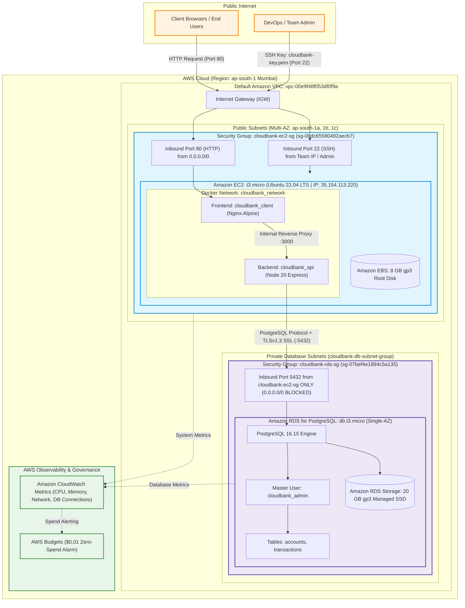

# CloudBank — Final Architecture Diagrams (Week 4)
## Capital One AWS Cloud Migration Case Study (Group 41 · IT457)

**Team Members**:
- **Dhruvil Patel (202301035)** — Frontend Architecture, Performance Benchmarking & Cost Modeling
- **Aryan Rathod (202301164)** — Docker Containerization & AWS Infrastructure Deployment
- **Kavish Patel (202301074)** — Backend REST API & Database Systems

This document provides the definitive, production-grade architecture diagrams for both the **Local Docker Baseline** and the **Modernized AWS Cloud Deployment** implemented for the CloudBank digital banking application.

---

## 1. Architecture 1: Local Docker Containerized Baseline

### 1.1 Mermaid Diagram (Local Docker)

```mermaid
flowchart TD
    subgraph Host["Developer Host Machine (Localhost)"]
        Browser["User Web Browser"]
        
        subgraph DockerNetwork["Internal Docker Bridge Network: cloudbank_net"]
            subgraph ClientContainer["Frontend Container: cloudbank_client"]
                Nginx["Nginx Web Server (Port 80)"]
                ReactSPA["React + Vite Static SPA Bundle"]
                ReverseProxy["Reverse Proxy: /api/* -> backend:3000"]
                Nginx --> ReactSPA
                Nginx --> ReverseProxy
            end
            
            subgraph APIContainer["Backend Container: cloudbank_api"]
                Express["Node.js Express REST API (Port 3000)"]
                Routes["Routes: /health, /accounts, /transactions"]
                TxEngine["Atomic Transaction Engine (BEGIN...COMMIT)"]
                Pool["pg Connection Pool (Max: 20)"]
                Express --> Routes
                Routes --> TxEngine
                TxEngine --> Pool
            end
            
            subgraph DBContainer["Database Container: cloudbank_db"]
                Postgres["PostgreSQL 16 Alpine (Port 5432 - Internal Only)"]
                InitSchema["01-init.sql (Accounts, Transactions, Indexes)"]
                SeedData["02-seed.sql (Demo Checking & Demo Savings)"]
                Postgres --> InitSchema
                Postgres --> SeedData
            end
        end
        
        subgraph Storage["Persistent Host Storage"]
            NamedVolume[("Docker Named Volume: cloudbank_postgres_data")]
        end
    end

    Browser -- "HTTP :80" --> Nginx
    ReverseProxy -- "Internal HTTP :3000" --> Express
    Pool -- "PostgreSQL TCP :5432 (Non-Exposed)" --> Postgres
    Postgres -- "Mount: /var/lib/postgresql/data" --> NamedVolume

    classDef client fill:#e1f5fe,stroke:#0288d1,stroke-width:2px;
    classDef api fill:#e8f5e9,stroke:#388e3c,stroke-width:2px;
    classDef db fill:#ede7f6,stroke:#512da8,stroke-width:2px;
    classDef storage fill:#fff3e0,stroke:#f57c00,stroke-width:2px;

    class ClientContainer client;
    class APIContainer api;
    class DBContainer db;
    class Storage storage;
```



### 1.2 ASCII Architecture Topology (Local Docker)

```text
 ┌──────────────────────────────────────────────────────────────────────────────────────────┐
 │                         DEVELOPER HOST MACHINE (Apple Silicon / macOS)                   │
 │                                                                                          │
 │   User Web Browser                                                                       │
 │          │                                                                               │
 │          │ HTTP (Port 80)                                                                │
 │          ▼                                                                               │
 │   ┌──────────────────────────────────────────────────────────────────────────────────┐   │
 │   │                   Docker Bridge Network: cloudbank_net                           │   │
 │   │                                                                                  │   │
 │   │   ┌─────────────────────────────────┐                                            │   │
 │   │   │ Frontend: cloudbank_client      │                                            │   │
 │   │   │ - Image: nginx:alpine           │                                            │   │
 │   │   │ - Host Port: 80 -> Internal: 80 │                                            │   │
 │   │   │ - Serves React + Vite bundle    │                                            │   │
 │   │   │ - Reverse proxies /api/* ───────┼────────┐ (Internal HTTP)                   │   │
 │   │   └─────────────────────────────────┘        │                                   │   │
 │   │                                              ▼                                   │   │
 │   │                             ┌──────────────────────────────────┐                 │   │
 │   │                             │ Backend: cloudbank_api           │                 │   │
 │   │                             │ - Image: node:20-alpine          │                 │   │
 │   │                             │ - Host Port: 3000                │                 │   │
 │   │                             │ - Express REST API               │                 │   │
 │   │                             │ - Atomic BEGIN...COMMIT Engine   │                 │   │
 │   │                             │ - Connection Pool: max 20        │                 │   │
 │   │                             └────────────────┬─────────────────┘                 │   │
 │   │                                              │                                   │   │
 │   │                                              │ PostgreSQL TCP (Port 5432)        │   │
 │   │                                              │ STRICTLY INTERNAL                 │   │
 │   │                                              ▼                                   │   │
 │   │                             ┌──────────────────────────────────┐                 │   │
 │   │                             │ Database: cloudbank_db           │                 │   │
 │   │                             │ - Image: postgres:16-alpine      │                 │   │
 │   │                             │ - Host Port: NONE (Unmapped)     │                 │   │
 │   │                             │ - Auto-seeds: init.sql, seed.sql │                 │   │
 │   │                             └────────────────┬─────────────────┘                 │   │
 │   │                                              │                                   │   │
 │   └──────────────────────────────────────────────┼───────────────────────────────────┘   │
 │                                                  │ Mounts to /var/lib/postgresql/data    │
 │                                                  ▼                                       │
 │                                 ┌──────────────────────────────────┐                     │
 │                                 │ Named Volume:                    │                     │
 │                                 │ cloudbank_postgres_data          │                     │
 │                                 └──────────────────────────────────┘                     │
 └──────────────────────────────────────────────────────────────────────────────────────────┘
```

---

## 2. Architecture 2: Modernized AWS Cloud Production (Capital One Pattern)

### 2.1 Mermaid Diagram (AWS Cloud Modernization)



### 2.2 ASCII Architecture Topology (AWS Cloud Modernization)

```text
  ══════════════════════════════════════════════════════════════════════════════════════════════════
                                    AWS CLOUD (ap-south-1 Mumbai)
  ══════════════════════════════════════════════════════════════════════════════════════════════════

      Public Users / Internet                             DevOps / Team Admin
                 │                                                  │
                 │ HTTP (Port 80)                                   │ SSH (Port 22) + cloudbank-key.pem
                 ▼                                                  ▼
  ┌──────────────────────────────────────────────────────────────────────────────────────────────┐
  │ Amazon VPC (Default: vpc-00e9f48f053df0f9a)                                                  │
  │                                                                                              │
  │   Internet Gateway (IGW)                                                                     │
  │      │                                                                                       │
  │      ▼                                                                                       │
  │   ┌──────────────────────────────────────────────────────────────────────────────────────┐   │
  │   │ EC2 Security Group: cloudbank-ec2-sg (sg-0bdc65580492aecb7)                          │   │
  │   │ - Port 80 (HTTP): Inbound from 0.0.0.0/0 (Public Internet)                           │   │
  │   │ - Port 22 (SSH):  Inbound from Team Admin IP                                         │   │
  │   │                                                                                      │   │
  │   │   ┌──────────────────────────────────────────────────────────────────────────────┐   │   │
  │   │   │ Amazon EC2 Instance: t3.micro (Ubuntu 22.04 LTS, 1 vCPU, 1 GB RAM)           │   │   │
  │   │   │ Public IPv4: 35.154.113.220 | Root Storage: 8 GB gp3 SSD                     │   │   │
  │   │   │                                                                              │   │   │
  │   │   │   ┌─────────────────────────────────┐   Docker Network                       │   │   │
  │   │   │   │ Frontend: cloudbank_client      │   (cloudbank_network)                  │   │   │
  │   │   │   │ - Nginx 1.31.8 (Port 80)        │                                        │   │   │
  │   │   │   │ - React + Vite Static SPA       │                                        │   │   │
  │   │   │   │ - Reverse proxy /api/* ─────────┼───────┐                                │   │   │
  │   │   │   └─────────────────────────────────┘       │ Internal HTTP (:3000)          │   │   │
  │   │   │                                             ▼                                │   │   │
  │   │   │                                 ┌─────────────────────────┐                  │   │   │
  │   │   │                                 │ Backend: cloudbank_api  │                  │   │   │
  │   │   │                                 │ - Node 20 Express       │                  │   │   │
  │   │   │                                 │ - Port 3000             │                  │   │   │
  │   │   │                                 │ - Pool max: 20          │                  │   │   │
  │   │   │                                 └────────────┬────────────┘                  │   │   │
  │   │   └──────────────────────────────────────────────┼───────────────────────────────┘   │   │
  │   └──────────────────────────────────────────────────┼───────────────────────────────────┘   │
  │                                                      │                                       │
  │                                                      │ PostgreSQL Protocol (Port 5432)       │
  │                                                      │ Encrypted via TLSv1.3 SSL             │
  │                                                      │ Private VPC Routing                   │
  │                                                      ▼                                       │
  │   ┌──────────────────────────────────────────────────────────────────────────────────────┐   │
  │   │ RDS Security Group: cloudbank-rds-sg (sg-07bef4e1894c5a135)                          │   │
  │   │ - Port 5432: Inbound strictly from source SG sg-0bdc65580492aecb7                    │   │
  │   │ - 0.0.0.0/0: COMPLETELY BLOCKED (Database is 100% Private)                           │   │
  │   │                                                                                      │   │
  │   │   ┌──────────────────────────────────────────────────────────────────────────────┐   │   │
  │   │   │ Amazon RDS for PostgreSQL: db.t3.micro (Single-AZ)                           │   │   │
  │   │   │ Endpoint: cloudbank-db.cn0iuaqoonm9.ap-south-1.rds.amazonaws.com:5432        │   │   │
  │   │   │ Database: cloudbank | Engine: PostgreSQL 16.15                               │   │   │
  │   │   │ Storage: 20 GB gp3 General Purpose SSD                                       │   │   │
  │   │   │ Subnet Group: cloudbank-db-subnet-group (ap-south-1a, 1b, 1c)                │   │   │
  │   │   │ Backups: Automated point-in-time recovery & automated minor patching         │   │   │
  │   │   └──────────────────────────────────────────────────────────────────────────────┘   │   │
  │   └──────────────────────────────────────────────────────────────────────────────────────┘   │
  └──────────────────────────────────────────────────────────────────────────────────────────────┘

  ┌──────────────────────────────────────────────────────────────────────────────────────────────┐
  │ Observability & Telemetry:                                                                   │
  │ - Amazon CloudWatch: CPUUtilization, NetworkIn/Out, StatusCheckFailed, DatabaseConnections   │
  │ - AWS Budgets: Zero-Spend Alert ($0.01 limit) preventing unintended charges                  │
  └──────────────────────────────────────────────────────────────────────────────────────────────┘
```

---

## 3. Side-by-Side Architectural Comparison

| Dimension | Architecture 1: Local Docker Baseline | Architecture 2: AWS Cloud Modernization (Option A) | Capital One Case Study Modernization Pattern |
|---|---|---|---|
| **Compute Model** | 3 co-located containers on local developer laptop | Containerized web & API on Amazon EC2 (`t3.micro`) | Elastic virtual compute decoupled from developer machines |
| **Database Tier** | Self-hosted PostgreSQL container (`cloudbank_db`) | **Managed Amazon RDS for PostgreSQL (`db.t3.micro`)** | Elimination of self-managed database patching and administrative toil |
| **Network Boundaries** | Virtual bridge network (`172.x.x.x`) on loopback | **Amazon VPC + Defense-in-Depth Security Groups** | Multi-tier firewalling; database port 5432 is strictly private and non-routable |
| **Persistence Layer** | Docker named volume (`cloudbank_postgres_data`) | **Amazon EBS (gp3)** + **Amazon RDS Managed Storage** | Cloud durability (99.999%), independent storage volume lifecycle |
| **Encryption in Transit** | Plain unencrypted TCP | **Mandatory TLSv1.3 SSL (`rds.force_ssl`)** | Enterprise banking compliance (PCI-DSS) |
| **Failure Domain** | Single host failure (laptop crash stops all services) | **Decoupled tiers** (EC2 failure leaves database intact) | Multi-tier blast-radius containment |
| **Horizontal Scalability** | Bound by physical laptop CPU and RAM | Elastic scaling via Application Load Balancer & ASG | Dynamic traffic scaling during banking peak hours |
| **Observability** | Terminal stdout logs | **Amazon CloudWatch** metrics & alarm triggers | Centralized infrastructure telemetry and zero-spend alerts |
